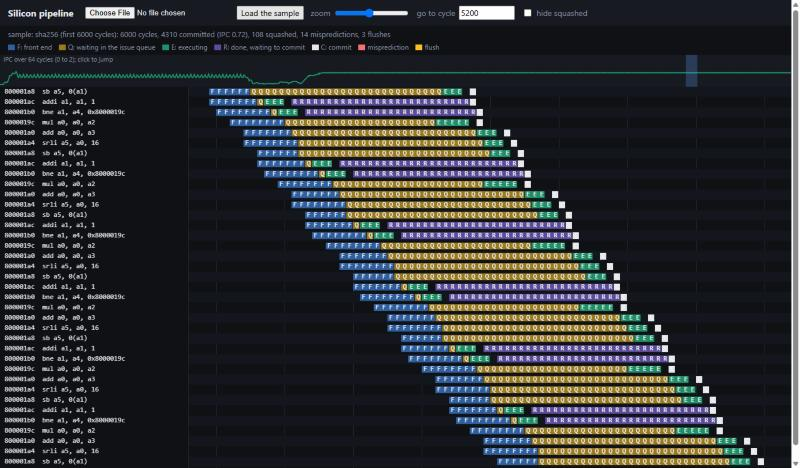

# Silicon

An out-of-order RISC-V processor designed as hardware: a two-wide superscalar
RV64IM core with register renaming, a reorder buffer, speculative execution
past predicted branches, a load/store queue and two caches, written in Chisel
(with the divider in hand-written SystemVerilog) and simulated with Verilator.
Every instruction it commits is compared, as it happens, with
[Rivet](https://github.com/YUStulinu/Rivet), my RISC-V emulator, used here as
the reference model.

| part | language | what it is |
|---|---|---|
| [`rtl/`](rtl/src/main/scala/silicon) | Chisel (Scala) | the core: fetch and prediction, decode and rename, issue, execution, load/store unit, caches, commit |
| [`SiliconDivider.sv`](rtl/src/main/resources/vsrc/SiliconDivider.sv) | SystemVerilog | the iterative divider, used from Chisel as a black box |
| [`golden/`](golden/src/lib.rs) | Rust | the reference model: Rivet stepped one instruction at a time, behind a C interface |
| [`sim/`](sim/main.cpp) | C++ | the Verilator harness: memory with latency, UART, co-simulation, statistics, pipeline trace |
| [`firmware/`](firmware) | C, Zig | start-up code, a small runtime and eleven benchmark programs |
| [`tests/`](tests) | Python | co-simulation tests (pytest) and a random program generator |
| [`viewer/`](viewer) | TypeScript | a cycle-by-cycle pipeline viewer |
| [`eval/`](eval) | Python | IPC, the latency sweep, synthesis with Yosys |



## The core

RV64IM with Zicsr and Zifencei, machine mode only. It fetches, renames and
commits two instructions per cycle and issues up to four.

**Front end.** An 8 KiB direct-mapped instruction cache with 32-byte lines
feeds two instructions per cycle. Predecode in the fetch stage finds the
branches and jumps in the fetched pair. Conditional branches use gshare: a
1024-entry table of 2-bit counters indexed by the PC xor a 10-bit global
history. `jal` is always taken, returns pop an 8-entry return address stack,
and other indirect jumps use a 16-entry target buffer. An 8-entry fetch buffer
separates fetch from rename. On a misprediction the history and the return
stack are restored from the copies the branch carried.

**Rename.** A 32-entry map table onto 64 physical registers, with a free
list and a ready table. Every branch takes one of 8 checkpoints, a copy of the
map table plus the free-list, ROB, load-queue and store-queue tails, so that a
misprediction is undone in one cycle. Every instruction carries a branch mask
naming the unresolved branches it depends on. A misprediction kills exactly
the instructions with that branch's bit, in every stage at once. A correct
resolution clears the bit everywhere.

**Issue and execution.** One 16-entry issue queue. Selection is by age, from
an age matrix, so the oldest ready instruction wins on each port. The four
ports are:

| port | units | latency |
|---|---|---|
| 0 | ALU, branch unit | 1 |
| 1 | ALU | 1 |
| 2 | multiplier (3-stage Wallace tree), divider (radix 2, SystemVerilog) | 3, up to 65 |
| 3 | address generation for loads and stores | — |

After selection come register read, execute and write-back. Single-cycle
results wake their dependents at selection time and reach them through
bypasses at register read and at execute, so dependent ALU instructions issue
back to back. Multiplications wake their dependents from the first multiplier
stage, so the dependents' register read meets the product on the bypass.
Divisions and loads, whose latency is not fixed, wake their dependents at
write-back.

**Memory.** An 8-entry load queue and an 8-entry store queue. Loads go to the
cache once their address is known, in any order, provided every older store
has a known address. A load that overlaps an older store takes the data from
it when the store covers the load, and waits otherwise. Stores write the
cache only after they commit. The data cache is 16 KiB, direct-mapped,
write-back and write-allocate. It is blocking: one miss at a time, but loads
that hit go on while the miss is being served. Addresses at 0x10000000 (the
UART) are uncached and accessed only when non-speculative.

**Commit.** A 32-entry reorder buffer commits up to two instructions per
cycle, in order. Exceptions (illegal instruction, misaligned access, ecall,
ebreak) are taken at commit, so they are precise. CSR instructions, `mret`,
`fence` and `fence.i` also run at commit: they wait until they are the oldest
instruction, then flush the pipeline behind them. `fence.i` also writes back
the data cache and invalidates the instruction cache.

**The in-order variant** is the same hardware with one change, made for the
comparison: the issue queue issues only its oldest instruction (and the
second oldest, if that one can use a different port), so execution starts in
program order. It keeps renaming, the predictor, the caches and the
dual-issue front end, so the comparison measures out-of-order issue alone.

Configurations (all built from [`Main.scala`](rtl/src/main/scala/silicon/Main.scala)):

| name | what it is |
|---|---|
| `ooo` | the core as described |
| `inorder` | in-order issue |
| `nopred` | no prediction: fetch always continues at the next instruction, and every taken branch or jump is a misprediction |
| `small` | ROB 16, issue queue 8, 48 physical registers, 4-entry load and store queues, 4 checkpoints |

## Verification

The simulator ([`sim/main.cpp`](sim/main.cpp)) passes each committed
instruction to the reference model, which runs the same instruction and
compares the PC, the encoding, the value written to the destination register,
the address and bytes of a store, and the cause and value of a trap. The first
difference stops the run. Some values cannot match an emulator, so they are
taken from the core instead: reads of `mcycle`/`cycle`, `misa` and
`mstatus`, and loads from the UART.

| suite | what it is | result (all four configurations) |
|---|---|---|
| riscv-tests | the official ISA tests, rv64ui and rv64um, with my own machine-mode environment ([`tests/env`](tests/env)) | 66 / 66 |
| firmware | 9 C and 2 Zig programs; each checks its own result against a value computed by a native build | 11 / 11 |
| random programs | [`randprog.py`](tests/randprog.py): ALU work, loads and stores at data-dependent addresses, branches, loops, calls, indirect jumps, illegal instructions, `ebreak`, CSR accesses, `fence`, `fence.i`; 600 instructions each | 900 / 900 (seeds 1000–1299 on ooo, inorder and small) |

`rv64ui-p-ma_data` is left out: it expects misaligned loads and stores to
work, and this core traps on them, which the specification allows.

A test (`test_checker_detects_corruption`) checks the checker itself: with
`SIM_CORRUPT_COMMIT=N` the harness flips a bit in the N-th committed value,
and the run must fail at that instruction.

Bugs these tests found during development, all now fixed:

- a 1-bit sum (`+` instead of `+&`) that made rename take two instructions
  when it had room for one, so instructions were duplicated;
- a missing bypass from the execute stage on the multiply and memory ports;
- `fence` and uncached loads waiting for every store in the queue, including
  younger ones that could not commit before them: a deadlock found by the
  random programs;
- a free list sized by the number of registers rather than a power of two,
  which broke the 48-register configuration;
- the mask of a new branch checkpoint overwritten in the same cycle by the
  step that clears resolved branches. Chisel keeps the last assignment, so
  the checkpoint kept the mask of the previous branch in that slot. After a
  misprediction, younger branches then kept their checkpoints until the next
  full flush. Nothing went wrong architecturally, but the core ran out of
  checkpoints and stalled. The stall counters added to the simulator showed
  it: `fib` spent 296,109 of 618,777 cycles waiting for a checkpoint. After
  the fix it runs in 349,648 cycles, and that stall is zero on every
  benchmark.

## Results

Everything below is in [`results/`](results), produced by
[`eval/run_all.sh`](eval/run_all.sh). The memory model answers a cache-line
request after a fixed latency, 20 cycles unless stated otherwise.

### IPC

IPC (instructions committed per cycle) of each configuration, and the speedup of `ooo` over `inorder` in cycles:

| benchmark | ooo | inorder | nopred | small | speedup of ooo over inorder |
|---|---:|---:|---:|---:|---:|
| bsearch | 0.488 | 0.421 | 0.435 | 0.463 | 1.16x |
| chase | 0.289 | 0.259 | 0.287 | 0.280 | 1.11x |
| crc32 | 1.140 | 0.864 | 0.835 | 1.128 | 1.32x |
| div | 0.048 | 0.048 | 0.046 | 0.048 | 1.00x |
| fib | 1.600 | 1.330 | 0.716 | 1.108 | 1.20x |
| matmul | 0.784 | 0.455 | 0.557 | 0.663 | 1.73x |
| nqueens | 1.292 | 1.234 | 1.091 | 0.996 | 1.05x |
| qsort | 0.651 | 0.560 | 0.513 | 0.626 | 1.16x |
| sha256 | 1.667 | 1.231 | 1.224 | 1.568 | 1.35x |
| sieve | 0.313 | 0.297 | 0.268 | 0.305 | 1.05x |
| strings | 0.409 | 0.334 | 0.326 | 0.407 | 1.23x |
| geometric mean | 0.561 | 0.467 | 0.438 | 0.512 | 1.20x |

Out-of-order issue is 1.20 times faster than in-order issue (geometric mean).
The gain is largest where independent work is available beyond a long
operation: in `matmul` multiplications and loads overlap (1.73×), and in
`sha256` and `crc32` the rounds have parallel ALU chains (1.35×, 1.32×). It is
nothing in `div`, which is one long dependence chain through the divider, and
small in `nqueens` and `sieve`. `nqueens` mispredicts a quarter of its
branches, so the window is mostly wrong-path work. `sieve` misses the data
cache on 6% of its instructions, and the blocking cache serves one miss at a
time whatever the order of issue.

Branch prediction is worth 28% over no prediction (`nopred`, 0.438). Halving the windows (`small`) costs 9%. The cost is
largest on the two recursive programs, `fib` (31%) and `nqueens` (23%), whose
calls and returns save and restore registers on the stack, so they need many
loads and stores in flight.

### Memory latency

Speedup of `ooo` over `inorder` at each memory latency, in cycles:

| benchmark | latency 5 | latency 20 | latency 50 | latency 100 |
|---|---:|---:|---:|---:|
| bsearch | 1.21x | 1.16x | 1.03x | 0.94x |
| chase | 1.15x | 1.11x | 1.08x | 1.05x |
| crc32 | 1.33x | 1.32x | 1.30x | 1.26x |
| div | 1.00x | 1.00x | 1.00x | 1.00x |
| fib | 1.20x | 1.20x | 1.20x | 1.20x |
| matmul | 1.82x | 1.73x | 1.63x | 1.41x |
| nqueens | 1.05x | 1.05x | 1.05x | 1.05x |
| qsort | 1.17x | 1.16x | 1.14x | 1.11x |
| sha256 | 1.36x | 1.35x | 1.34x | 1.31x |
| sieve | 1.15x | 1.05x | 1.02x | 1.01x |
| strings | 1.23x | 1.23x | 1.22x | 1.22x |

As memory becomes slower, the advantage of out-of-order issue shrinks. It
does not grow, as it would with a cache that served several misses at once.
With one miss at a time, more latency means more time with nothing to issue.
At 100 cycles `bsearch` is 6% slower out of order. It mispredicts 16% of its
branches, and the likely cause is loads on the wrong path that start cache
misses, which the correct path then waits behind; I have not measured how many
of its misses are on the wrong path. A non-blocking data cache is the main
missing piece of this core.

### Synthesis

| | ooo | inorder | small |
|---|---:|---:|---:|
| generic gates | 333651 | 333558 | 230686 |
| flip-flops | 38385 | 38385 | 26664 |
| longest path, gates | 105 | 105 | 83 |
| frequency estimate at 50 ps per gate level (MHz) | 190.5 | 190.5 | 241.0 |
| 7-series LUTs | 102456 | 104549 | 73150 |
| 7-series flip-flops | 38377 | 38377 | 26662 |
| 7-series DSP48 | 0 | 0 | 0 |
| longest path, 7-series cells | 44 | 41 | 33 |
| frequency estimate at 0.6 ns per cell (MHz) | 37.9 | 40.7 | 50.5 |
| cache SRAM bits (black boxes) | 235264 | 235264 | 235264 |

[`eval/synth.py`](eval/synth.py) synthesizes the generated SystemVerilog with
Yosys, in two ways. The cache tag and data arrays (235,264 bits) are left as
black boxes: they would be SRAM macros in a chip. Everything else is logic
and flip-flops, including the physical register file, the predictor tables
and the checkpoints.

- **Generic gates**: `synth -noabc`, then ABC mapping for delay
  (`strash; dch; map`). ABC's default, area-driven script turns the
  Brent-Kung adders Yosys builds into ripple chains: 119 levels instead of 26
  on a 130-bit adder. Depth is the longest path between flip-flops, in gates.
  At an assumed 50 ps per gate level (a loaded gate in a ~28 nm process), it
  gives the frequency estimate. This ignores wires and placement, so it is an
  upper bound.
- **Xilinx 7-series**: `synth_xilinx` without block or distributed RAM, so
  every register-file bit is a flip-flop. At an assumed 0.6 ns per cell
  level, including local routing, the depth gives a second estimate. No place
  and route was run.

The two variants are the same size. In-order issue changes only which
instruction the selector picks; the queue, the age matrix and everything
else stay. Out-of-order issue therefore costs no area here: the 20% comes
from logic the in-order variant also carries. A real in-order core would be
much smaller, because it would drop renaming and the issue queue too. The
`small` configuration is 31% smaller and 27% faster by logic depth, for 9%
less IPC.

Most signal names do not survive flattening and ABC, but the few that do on
the longest generic path are the computed branch target and the next fetch
PC (`target`, `nextPc`). That path runs from the branch unit's result to the
redirect of fetch. On the FPGA the longest path starts at an instruction held
in the ROB and goes through the trap decision at commit (`rob_9_inst`,
`takeTrap`). There are no DSP blocks because the multiplier is a hand-built
Wallace tree, not a `*`, so Yosys does not map it to DSP48s. Before the tree
replaced the `*`, and before the issue and load selections were rewritten as
an age matrix and a rotate-and-priority-encode, the longest generic path was
972 gates.

Running ABC for the three configurations in parallel on an 8 GB machine ran
out of memory, which is why `run_all.sh` runs them one at a time. CI
synthesizes only `small`, with the generic flow.

## Building and running

On Ubuntu 24.04 (I used WSL), with `verilator`, `yosys`,
`gcc-riscv64-unknown-elf`, a JDK 17, Rust, Python 3 with pytest, and Zig
0.14 (`tools/ci-setup.sh` installs sbt and Zig):

```bash
OUT=$PWD/build sh tools/build.sh ooo,inorder,nopred,small
```

```bash
SILICON_BUILD=$PWD/build SILICON_RANDOM=100 python3 -m pytest tests -q
```

```bash
build/sim-ooo build/fw/sha256.elf --cosim --stats stats.json --trace sha256.trace
```

```bash
OUT=$PWD/build sh eval/run_all.sh
```

`tools/build.sh` fetches riscv-tests at a pinned commit into `third_party/`,
builds the reference model with Cargo, generates SystemVerilog with Chisel
(sbt downloads Chisel 6.6 and firtool), compiles a simulator per
configuration with Verilator, and builds the ISA tests and the firmware.

The viewer is a static page: `cd viewer && npm install && npm run build`,
then serve the folder (for example `python3 -m http.server`) and open
`index.html`. It loads `sample/sha256.trace` (the first 6,000 cycles of
`sha256` on `ooo`), or any trace you open. Each instruction is a row with its
fetch, queue, execute, result and commit segments. Squashed instructions can
be hidden. There is an IPC graph over time.

## Limitations

- Machine mode only: no supervisor or user mode, no virtual memory, no
  interrupts (there is no timer or interrupt controller).
- No compressed instructions (C), no atomics (A), no floating point.
- Misaligned loads and stores trap instead of being split.
- The data cache is blocking (see the latency sweep), and both caches are
  direct-mapped.
- One issue queue for all ports, and stores issue their address and data
  together.
- The frequency figures are estimates from logic depth, not timing after place
  and route, and the cache arrays are not synthesized.

## License

MIT
